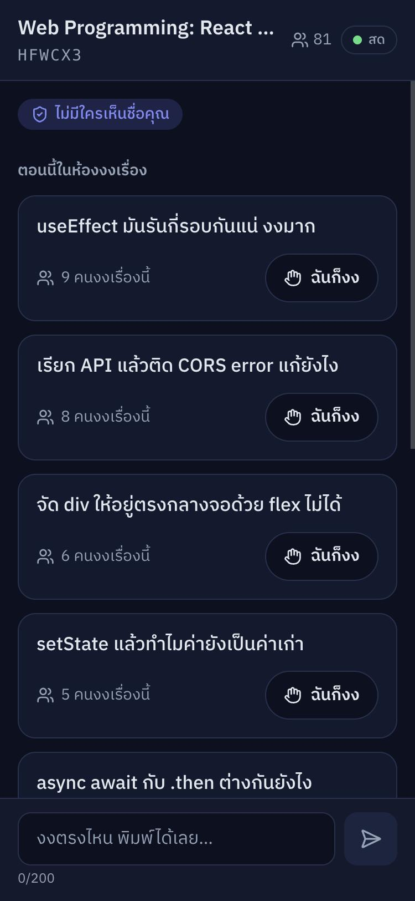
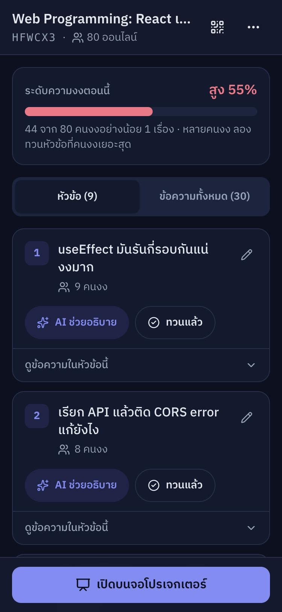
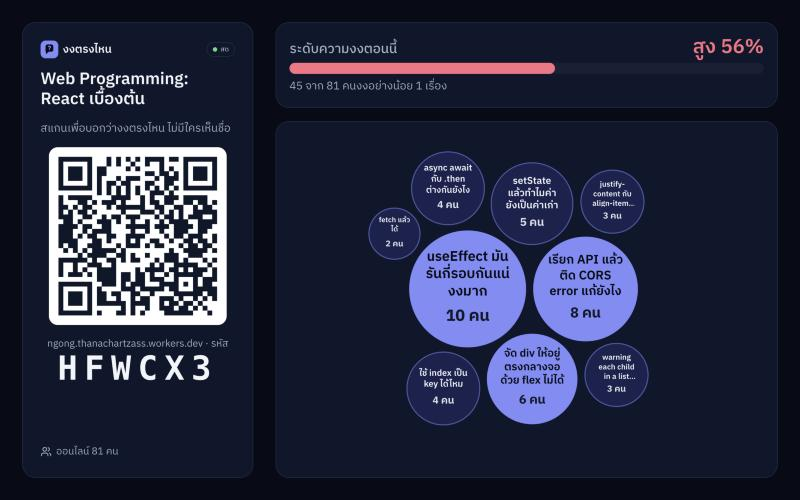
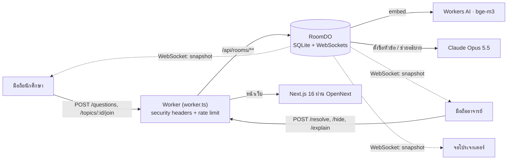
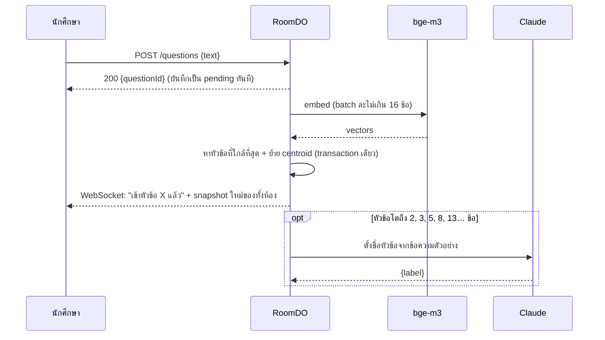
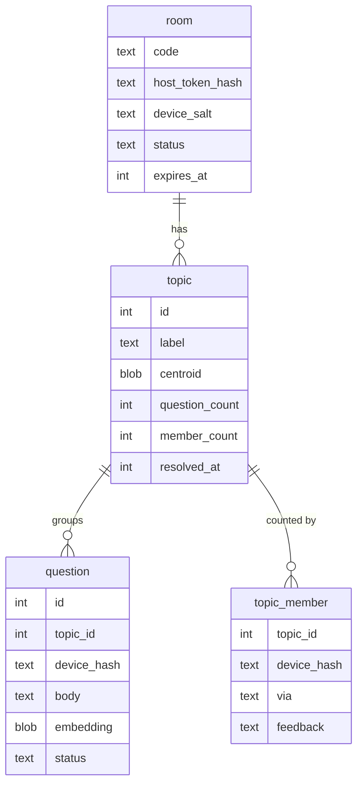

<div align="center">

# งงตรงไหน · Ngong

**ถามได้ ไม่ต้องยกมือ**
ส่งความงงแบบไม่ระบุชื่อ แล้ว AI รวมเรื่องที่ทั้งห้องงงให้อาจารย์เห็นแบบเรียลไทม์

**[Live Demo → ngong.thanachartzass.workers.dev](https://ngong.thanachartzass.workers.dev)**

[วิธีใช้](#วิธีใช้) · [Architecture](#architecture) · [Data Model](#data-model) · [ความปลอดภัย](#ความปลอดภัย) · [เริ่มต้นพัฒนา](#เริ่มต้นพัฒนา)

</div>

| นักศึกษา (มือถือ) | อาจารย์ (มือถือ) | จอโปรเจกเตอร์ |
|---|---|---|
|  |  |  |

## ปัญหา
ในห้องเรียนไทย นักศึกษาส่วนใหญ่ไม่กล้ายกมือถาม เพราะเกรงใจ กลัวเพื่อนมองว่าไม่เข้าใจ หรือกลัวถามซ้ำกับคนอื่น
อาจารย์เลยไม่รู้ว่าห้องงงตรงไหน จนมารู้อีกทีตอนคะแนนสอบออก

เครื่องมือ Q&A ที่มีอยู่ เช่น Slido หรือ Mentimeter ให้ถามแบบไม่ระบุชื่อได้ก็จริง แต่ได้คำถามมาเป็นลิสต์ยาว
อาจารย์ต้องหยุดสอนมาอ่านทีละข้อ และมองไม่ออกว่าเรื่องไหนที่คนงงเยอะที่สุด

## ทางแก้
- นักศึกษาสแกน QR แล้วพิมพ์ว่างงตรงไหน **ไม่ต้องสมัคร ไม่ต้องล็อกอิน ไม่มีใครเห็นชื่อ**
- AI **จัดความงงที่ความหมายคล้ายกันไว้หัวข้อเดียวกัน** แม้จะพิมพ์ด้วยคำต่างกัน
- อาจารย์เห็นเป็นหัวข้อพร้อมจำนวนคน เช่น "10 คนงงเรื่อง useEffect" ดูแวบเดียวก็รู้ว่าต้องทวนเรื่องไหน
- **ข้อความดิบมีแค่อาจารย์ที่เห็น** เพื่อนในห้องเห็นแค่ชื่อหัวข้อ คนส่งเลยไม่ต้องกลัว และคนป่วนก็ไม่มีผู้ชม

## ฟีเจอร์
**นักศึกษา**
- ส่งความงงแบบไม่ระบุตัวตน และรู้ทันทีว่าข้อความถูกจัดเข้าหัวข้อไหน
- กด "ฉันก็งง" ในหัวข้อที่เพื่อนส่งมาได้ ไม่ต้องพิมพ์ซ้ำ
- เมื่ออาจารย์ทวนแล้ว ตอบได้ว่า "เข้าใจแล้ว" หรือ "ยังงงอยู่"

**อาจารย์**
- สร้างห้องได้ในคลิกเดียว ได้ QR และรหัสห้อง 6 ตัว
- ดูระดับความงงของทั้งห้อง และหัวข้อที่เรียงตามจำนวนคน
- เปิดดูข้อความดิบของแต่ละหัวข้อ ซ่อนข้อความที่ไม่เหมาะสม และแก้ชื่อหัวข้อได้
- กด "AI ช่วยอธิบาย" เพื่อให้ AI เสนอวิธีอธิบายเรื่องนั้นใหม่พร้อมตัวอย่าง
- จอโปรเจกเตอร์แยกเป็นแบบอ่านอย่างเดียว ไม่มีข้อความดิบ ฉายขึ้นจอได้อย่างปลอดภัย
- โหมด "จำลองห้องเรียน" สำหรับลองระบบโดยไม่ต้องมีนักศึกษาจริง

## วิธีใช้
1. เปิด [ngong.thanachartzass.workers.dev](https://ngong.thanachartzass.workers.dev) แล้วกด **สร้างห้องสำหรับผู้สอน**
2. กด **เปิดบนจอโปรเจกเตอร์** บนโน้ตบุ๊ก แล้วให้นักศึกษาสแกน QR บนจอ
3. นักศึกษาพิมพ์สิ่งที่งง bubble ของแต่ละหัวข้อจะโตขึ้นสดๆ
4. ถ้าอยากลองคนเดียว ให้กดเมนู `⋯` → **จำลองห้องเรียน** ระบบจะทยอยส่งคำถามตัวอย่าง 30 ข้อ แล้วมีคนกด "ฉันก็งง" ตามมาอีก 14 ครั้ง

## Tech Stack
| ส่วน | เทคโนโลยี | เหตุผล |
|---|---|---|
| Frontend | Next.js 16 (App Router), React 19, Tailwind CSS 4, motion, lucide-react, vaul | เขียนเร็ว bundle เล็ก ไอค่อนชุดเดียวทั้งแอป และมี bottom sheet ที่ใช้นิ้วปัดได้บนมือถือ |
| Hosting | Cloudflare Workers ผ่าน `@opennextjs/cloudflare` | รันใกล้ผู้ใช้ และ deploy ทั้ง frontend กับ backend เป็น Worker ตัวเดียว |
| Realtime + Database | Durable Objects (SQLite + WebSocket Hibernation) | 1 ห้อง = 1 object ทำงานทีละคำขอ ข้อมูลกับ realtime อยู่ที่เดียวกัน |
| Embeddings | Workers AI `@cf/baai/bge-m3` | รองรับภาษาไทย และเรียกจาก Worker ได้โดยตรง |
| LLM | Claude Opus 5.5 (effort `low`) ผ่าน `@anthropic-ai/sdk` | ภาษาไทยดี ใช้แค่ตั้งชื่อหัวข้อกับช่วยอธิบาย ไม่ได้ใช้จัดกลุ่ม |
| Validation / Test | zod 4, vitest | schema ชุดเดียวใช้ได้ทั้ง client และ server |

## Architecture


- ฝั่ง **client → server ใช้ HTTP POST** ส่วน **server → client ใช้ WebSocket** การ validate และ rate limit เลยอยู่ที่เดียว ฝั่ง WebSocket ไม่ต้องเชื่อข้อมูลจาก client เลย
- client ส่ง `ping` ทุก 25 วินาทีเพื่อไม่ให้เครือข่ายมือถือตัดการเชื่อมต่อ Durable Object ตอบกลับด้วย auto-response ได้โดยไม่ต้องตื่น
- ถ้า WebSocket หลุด client จะต่อใหม่แบบ exponential backoff + jitter (ทั้งห้องจะได้ไม่ต่อใหม่พร้อมกัน) ถ้าหลุดติดกันหลายครั้งจะเปลี่ยนไป poll ทุก 5 วินาทีจนกว่าจะต่อได้



## การจัดกลุ่มความงง
- แปลงข้อความเป็น vector 1024 มิติด้วย bge-m3 แล้ว normalize ให้ยาว 1
- ใช้ **online leader clustering**: เทียบ cosine similarity กับ centroid ของทุกหัวข้อ ถ้าค่าสูงสุดถึง threshold ก็เข้าหัวข้อนั้น ถ้าไม่ถึงก็เปิดหัวข้อใหม่ ใช้เวลา O(k) ต่อข้อความ และไม่ต้องกำหนดจำนวนกลุ่มล่วงหน้าแบบ k-means
- คิวจัดกลุ่มทำงานทีละรายการใน Durable Object คำถามคล้ายกันสองข้อที่เข้ามาพร้อมกันจึงไม่แย่งกันเปิดหัวข้อใหม่
- **threshold = 0.56 ได้มาจากการวัดจริง** ด้วยคำถามภาษาไทย 30 ข้อ 6 หัวข้อ (`scripts/demo-questions.json`) ผ่าน endpoint `/api/dev/tune` ที่เปิดเฉพาะตอน dev

| threshold | หัวข้อที่ได้ (เฉลย 6) | purity | หัวข้อที่ไม่ถูกแยก |
|---|---|---|---|
| ≤ 0.50 | 1 | 0.17 | 100% (รวมทุกอย่างเป็นก้อนเดียว) |
| 0.51 – 0.54 | 7 | 0.93 | 50% |
| **0.55 – 0.57** | **9** | **1.00** | **50%** |
| 0.58 – 0.60 | 12 | 1.00 | 17% |
| 0.72 (ค่าที่เดาไว้ก่อนวัด) | 25 | 1.00 | 0% |

  คำถามหัวข้อเดียวกันมี similarity เฉลี่ย 0.61 ส่วนคนละหัวข้อเฉลี่ย 0.44 แต่สองช่วงนี้ซ้อนกัน จึงเลือกค่ากลางของช่วงที่ purity = 1.00 เพราะการแยกเรื่องเดียวเป็นสองหัวข้อทำให้อาจารย์เข้าใจผิดน้อยกว่าการรวมสองเรื่องเป็นหัวข้อเดียว
- LLM ไม่ได้ใช้จัดกลุ่ม ใช้แค่ตั้งชื่อหัวข้อตอนกลุ่มโตถึงขนาดที่กำหนด (ลำดับ Fibonacci) จึงเร็ว ประหยัด และผลไม่แกว่ง ถ้าไม่มี API key จะใช้ข้อความที่ใกล้ centroid ที่สุด (medoid) เป็นชื่อแทน

## Data Model
SQLite แยกตามห้อง (อยู่ใน Durable Object ของแต่ละห้อง) จึงไม่มีคอลัมน์ `room_id` เลย ดู schema เต็มได้ที่ [`src/server/db/migrations.ts`](src/server/db/migrations.ts)



- ทุกตารางเป็น `STRICT` และมี `CHECK` constraint เช่นความยาวข้อความและค่า enum
- เก็บ counter ไว้ในตาราง `topic` (`question_count`, `member_count`, `understood_count`, `still_confused_count`) และอัปเดตใน `transactionSync` เดียวกับแถวที่มันนับ การสร้าง snapshot เลยไม่ต้อง `COUNT(*)` ทั้งตาราง
- index ทุกตัวสร้างมาเพื่อ query ใดสักตัวโดยเฉพาะ เช่น partial index `question_to_embed` สำหรับคิว embed และ `question_by_device` สำหรับ rate limit
- ทุก query อยู่ใน [`queries.ts`](src/server/db/queries.ts) และใช้ parameter binding (`?`) ทั้งหมด
- embedding เก็บเป็น Float32 bytes (BLOB) ขนาด 4 KB ต่อข้อความ ประมาณ 1/3 ของการเก็บเป็น JSON
- ข้อมูลถูกลบอัตโนมัติเมื่อครบ 24 ชั่วโมงผ่าน Durable Object alarm (`deleteAll()`)

## ความปลอดภัย
| ความเสี่ยง | วิธีป้องกัน |
|---|---|
| ปลอมเป็นอาจารย์ | host token สุ่ม 32 bytes ส่งเป็น cookie `HttpOnly; Secure; SameSite=Strict; Path=/api/rooms/{code}` ฝั่งเซิร์ฟเวอร์เก็บแค่ SHA-256 และเทียบแบบ constant-time |
| CSRF / WebSocket hijacking | ทุก POST/PATCH/DELETE และทุก WebSocket upgrade ต้องมี `Origin` ตรงกับเว็บเราเท่านั้น |
| แอบส่ง header ภายในมาเอง | worker ลบ `X-Ngong-*` ที่มากับ request แล้วใส่ค่าใหม่จาก cookie เอง |
| สแปม / flood | rate limit ต่ออุปกรณ์ใน DO (ส่งได้ 1 ครั้งต่อ 10 วินาที) + rate limit ต่อ IP (Workers Rate Limiting) + จำกัดคำถาม หัวข้อ และ WebSocket ต่อห้อง + body ไม่เกิน 4 KB |
| ข้อความหยาบ / ป่วน | นักศึกษาเห็นแค่ชื่อหัวข้อ, ปิดคำหยาบด้วย `•••` (ไม่ทิ้งทั้งข้อความ เพราะ "งงสัส ๆ" ก็ยังเป็นความงงจริง), อาจารย์ซ่อนข้อความได้ |
| Prompt injection | ห่อข้อความผู้ใช้ด้วย `<question>` (แทน `<` `>` ข้างใน), สั่งใน system prompt ว่าเป็นข้อมูลเท่านั้น, บังคับ JSON schema และตรวจด้วย zod อีกชั้น |
| SQL injection | parameter binding ทุก query และ validate ด้วย zod ก่อนถึง DB |
| XSS / clickjacking | CSP แบบ nonce ต่อ request (`'strict-dynamic'`), `frame-ancestors 'none'`, ไม่มี `dangerouslySetInnerHTML` เลย (QR วาดเป็น SVG path) |
| เดารหัสห้อง | 31⁶ ≈ 887 ล้านแบบ ตัดตัวอักษรที่หน้าตาคล้ายกันออก และสุ่มแบบไม่มี modulo bias ต่อให้เดาถูกก็เห็นแค่ชื่อหัวข้อ request ไปห้องที่ไม่มีอยู่จะไม่สร้างตารางทิ้งไว้ |
| ความเป็นส่วนตัว | ไม่เก็บชื่อ อีเมล หรือ IP, device id ถูก hash ด้วย salt ประจำห้อง (ข้ามห้องแล้วโยงกันไม่ได้), log ไม่มีข้อความ |
| Secrets | `ANTHROPIC_API_KEY` อยู่ใน `wrangler secret`, `.dev.vars` อยู่ใน `.gitignore` |

ทดสอบกับ Worker จริงแล้ว ผลเป็นตามที่ตั้งใจทุกข้อ: POST จาก origin อื่นได้ 403, ไม่มี Origin ได้ 403, ทำ host action โดยไม่มี cookie ได้ 401, body ยาวเกิน 200 ตัวอักษรได้ 400, Content-Type ผิดได้ 400, ส่งซ้ำภายใน 10 วินาทีได้ 429, WebSocket จาก origin อื่นได้ 403, ขอ WebSocket แบบ host โดยไม่มี cookie ได้ 401, ส่ง `X-Ngong-Host-Token` ปลอมมาได้ 401, ข้อความ `<script>` ถูกเก็บและแสดงเป็นข้อความธรรมดา

> `npm audit` แจ้ง high 4 รายการ ทั้งหมดมาจากเรื่องเดียว คือ `glob` CLI (flag `-c`) ที่ OpenNext ใช้ตอน build เท่านั้น ไม่ได้อยู่ใน Worker ที่ deploy จึงไม่มีผลกับเว็บที่ใช้งานจริง

## UX/UI
- ออกแบบสำหรับมือถือก่อน (360–390px) ปุ่มทุกปุ่มสูงอย่างน้อย 44px และปุ่มหลักอยู่ในระยะนิ้วโป้ง
- ช่องพิมพ์ติดขอบล่างและลอยเหนือคีย์บอร์ดเสมอ (`interactive-widget=resizes-content`, `100dvh`, safe-area inset)
- ใช้ไอค่อน lucide ชุดเดียวทั้งแอป ไม่มีอีโมจิ ทุกไอค่อนมีข้อความหรือ `aria-label` กำกับ
- contrast ผ่าน WCAG 2.2 AA ทั้งธีมสว่างและธีมมืด ระดับความงงแสดงทั้งสี คำ และตัวเลข จึงไม่ได้พึ่งสีอย่างเดียว
- เคารพ `prefers-reduced-motion`, ใช้ `aria-live` กับ toast, ฟอนต์ IBM Plex Sans Thai พร้อม line-height 1.7 ให้สระบนล่างไม่ชนกัน
- มีครบทุก state: กำลังโหลด (skeleton), ว่าง, ออฟไลน์, ห้องไม่เจอ, ห้องปิด, ห้องถูกลบ, ติด rate limit (นับถอยหลังบนปุ่มส่ง), AI ไม่ว่าง

## เริ่มต้นพัฒนา
ต้องมี Node.js 22+ และบัญชี Cloudflare (Free plan ใช้ได้) ส่วน Anthropic API key ไม่บังคับ ถ้าไม่มี ชื่อหัวข้อจะใช้ข้อความตัวแทนแทน

```bash
git clone https://github.com/Vinner007/ngong.git
cd ngong
npm install
cp .dev.vars.example .dev.vars   # ใส่ ANTHROPIC_API_KEY ถ้ามี
npx opennextjs-cloudflare build
npx wrangler dev                 # http://localhost:8787 (มี Durable Objects + WebSocket)
```

> `npm run dev` (next dev) เหมาะสำหรับแก้ UI แต่ไม่ได้รัน Durable Objects หรือ WebSocket ถ้าจะทดสอบ realtime ให้ build แล้วใช้ `wrangler dev` ตามด้านบน (หยุด `wrangler dev` ก่อน build ใหม่ทุกครั้ง)

Deploy:
```bash
npx wrangler login
npx wrangler secret put ANTHROPIC_API_KEY
npm run deploy
```

| Script | ทำอะไร |
|---|---|
| `npm run dev` | Next dev server สำหรับแก้ UI |
| `npm run preview` | build ด้วย OpenNext แล้วรันบน workerd |
| `npm run deploy` | build แล้ว deploy ขึ้น Cloudflare |
| `npm run check` | type check + lint + unit tests (25 tests) |
| `npm run cf-typegen` | สร้าง type ของ bindings จาก `wrangler.jsonc` |

## โครงสร้างโปรเจกต์
```
worker.ts                     # entry: ส่ง /api/** ให้ API, ที่เหลือให้ Next.js, ใส่ security headers
wrangler.jsonc                # Durable Object, Workers AI, rate limits
src/app/                      # หน้า /, /r/[code], /host/[code], /screen/[code]
src/components/               # UI แยกตาม student / host / screen / ui
src/lib/use-room.ts           # WebSocket client + reconnect + poll fallback
src/lib/api-client.ts         # เรียก API แบบมี type
src/server/api.ts             # routing, origin check, rate limit, cookies
src/server/room-do.ts         # Durable Object ของแต่ละห้อง (คิว, WebSocket, alarm)
src/server/db/                # migrations, queries, repository
src/server/clustering.ts      # คณิตศาสตร์ล้วน (มี unit test)
src/server/ai.ts              # bge-m3 + Claude
src/server/security.ts        # cookie, hash, constant-time compare, headers
src/shared/                   # zod schemas, limits (มีเหตุผลกำกับทุกค่า), types
scripts/demo-questions.json   # ชุดคำถามสำหรับเดโมและจูน threshold
tests/                        # unit tests
```

## ทำไมถึงออกแบบแบบนี้
- **ทำไมใช้ Durable Objects แทน database + polling?** ทุกคนในห้องต้องเห็นข้อมูลชุดเดียวกันทันที DO ทำงานทีละคำขอต่อห้อง จึงไม่มี race ตอนจัดกลุ่ม และ broadcast ผ่าน WebSocket ได้จากที่เดียวกับข้อมูล
- **ทำไมไม่ให้ LLM จัดกลุ่มทั้งหมด?** เรียก LLM ทุกข้อความทั้งช้าและแพง และผลก็ไม่คงที่ ส่วน embeddings + cosine ใช้เวลาแค่มิลลิวินาที อธิบายได้ และวัดผลได้
- **ทำไมนักศึกษาไม่เห็นข้อความดิบ?** คนส่งจะได้ไม่ต้องกลัวเพื่อนอ่าน และคนป่วนก็ไม่มีผู้ชม
- **ทำไม client ส่งข้อมูลผ่าน HTTP แต่รับผ่าน WebSocket?** validate และ rate limit อยู่ที่เดียว ส่วน WebSocket ไม่ต้อง parse ข้อมูลจาก client เลย

## ข้อจำกัดและสิ่งที่จะทำต่อ
- ยังแยกบางเรื่องออกเป็นสองหัวข้อ (ชุดทดสอบได้ 9 หัวข้อจากที่ควรเป็น 6) ขั้นต่อไปคือรวมหัวข้อที่ centroid เข้าใกล้กันเมื่อกลุ่มโตขึ้น
- threshold ค่าเดียวอาจไม่เหมาะกับทุกวิชา จะทำให้ปรับได้ต่อห้อง
- Workers Rate Limiting นับแยกตาม data center จึงเป็นด่านแรกเท่านั้น ด่านที่เข้มจริงคือ rate limit ต่ออุปกรณ์ใน DO
- อยากผูกความงงกับหน้าสไลด์ที่กำลังสอน ส่งสรุปหลังคาบให้อาจารย์ และเพิ่ม LINE Login ให้อาจารย์

## การใช้ AI ในการพัฒนา
โปรเจกต์นี้ใช้ Claude Code ช่วยเขียนโค้ด ส่วนการเลือกปัญหา การออกแบบ architecture, data model และ threat model, การวัดเพื่อเลือก threshold และการรีวิวโค้ดทุกไฟล์ เป็นสิ่งที่ผู้พัฒนาทำเอง

## ผู้พัฒนา
ธนชาติ ราชบัณดิษฐ (Tiger) · [thanachart.dev](https://thanachart.dev)
สร้างเพื่อส่งโจทย์ Web Programming ของ Young Webmaster Camp
